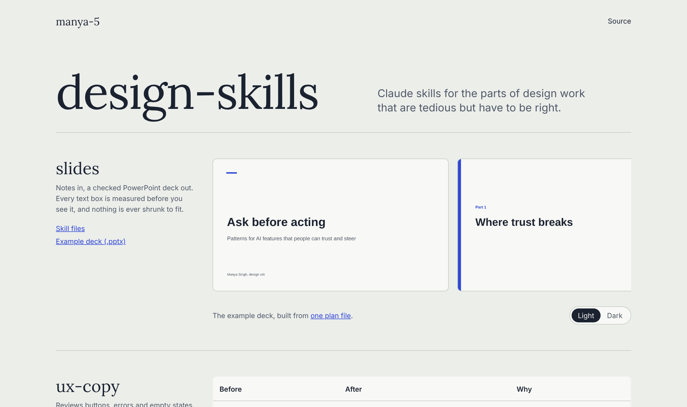

# design-skills

Claude skills for designers: slide decks, UX copy review and design handoff.



**Live:** https://manya-5.github.io/design-skills/

## Why I built this

I kept giving Claude the same long instructions for the same kinds of work. Skills let me write those instructions once and reuse them. These three cover work that is tedious but has to be right.

## How it works

Each skill is a folder with a `SKILL.md` that tells Claude when to use it and what steps to follow. Some also include scripts that Claude runs.

| Skill | What it does |
|---|---|
| [slides](skills/slides) | Turns notes into a 16:9 PowerPoint deck from 8 layouts, light or dark. The builder measures every text box with real font widths and warns instead of shrinking text. A render script lets Claude look at every slide before handing it over. |
| [ux-copy](skills/ux-copy) | Reviews interface copy. A script flags mechanical problems (Title Case, vague errors, em dashes, "Submit"), then Claude reviews the rest by hand and returns a before and after table. |
| [design-handoff](skills/design-handoff) | Turns screens into a spec engineers can build from: every state, edge case and string, plus open questions with suggested defaults. |

The slides skill follows the workflow of a presentation skill I built for a brand template, rewritten from scratch with its own neutral themes so it works for anyone.

## Run it locally

Install the skills into Claude Code:

```bash
git clone https://github.com/manya-5/design-skills.git
cp -r design-skills/skills/* ~/.claude/skills/
```

Try the slides builder on its own (needs Python 3 and LibreOffice for rendering):

```bash
pip install python-pptx
cd design-skills/skills/slides
python scripts/build_deck.py --plan examples/plan.json --out example.pptx
python scripts/render.py example.pptx renders/
```

Preview the site with `python3 -m http.server 8000 --directory docs` and open http://localhost:8000.
